# CS 643 - Cloud Computing - Programming Assignment 2

## Energy Consumption Prediction using Apache Spark MLlib, AWS EC2 and Docker

**Semester:** Fall 2026  
**Student:** Sai Nikhil Aluri  
**Implementation:** Python / PySpark on Ubuntu Linux

## Submission links

- [GitHub source code (main branch)](https://github.com/sai-nikhil-21/CS643-PA2-Energy-Prediction/tree/main)
- [Docker Hub image](https://hub.docker.com/r/sainikhild/cs643-energy-predictor)
- Image: `sainikhild/cs643-energy-predictor:v1`

## 1. Overview

This project trains an energy consumption regression model in parallel on four Amazon EC2 instances using Apache Spark MLlib. The trained pipeline is saved and subsequently loaded by a separate prediction application running on a single EC2 instance. The prediction application and its dependencies are also packaged in a Docker image, allowing prediction independently of the training cluster.

The application accepts the path to a local CSV file as a command-line argument and reports the root mean squared error (RMSE). The supplied validation dataset was used to evaluate candidate models and test both prediction methods. The instructor's hidden `TestDataset.csv` was not available during development.

| Component | Responsibility |
| --- | --- |
| Spark master | Schedules distributed training and hosts the driver |
| Four Spark worker processes | Execute distributed tasks across four EC2 hosts, including the master host |
| NFS shared directory | Provides a common filesystem for distributed model persistence |
| Training application | Fits preprocessing and regression models, evaluates validation RMSE, saves the best pipeline |
| Prediction application | Loads the saved pipeline, predicts energy consumption and prints RMSE |
| Docker image | Packages the prediction code, model, Java, Python and PySpark |

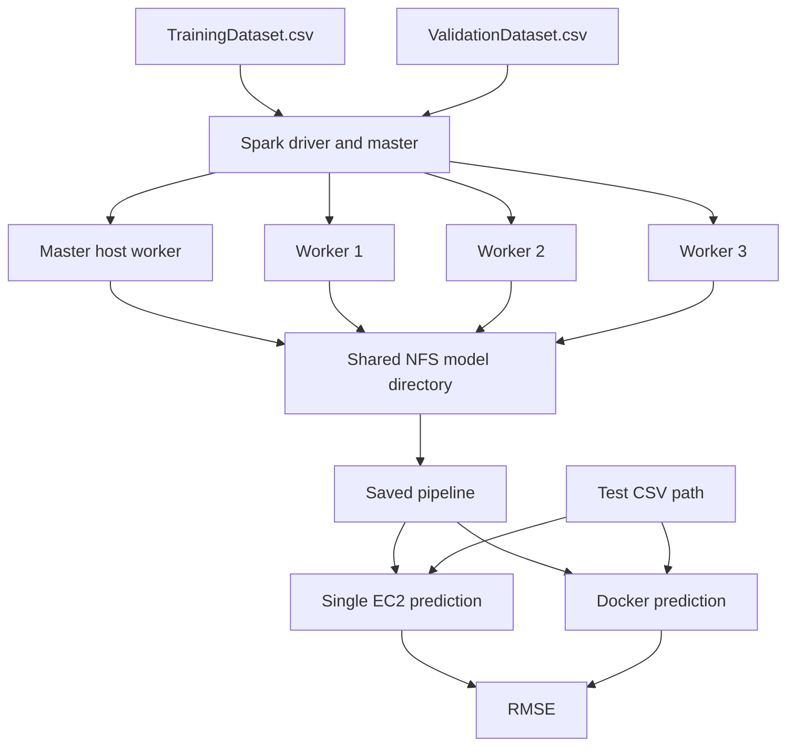

## 2. Files and requirements

Project root on the training master: `/home/ubuntu/CS643_PA2`.

| File or directory | Purpose |
| --- | --- |
| `training/train_model.py` | Distributed training application |
| `prediction/predict.py` | Independent prediction application |
| `data/TrainingDataset.csv` | Instructor-supplied training data (800 rows) |
| `data/ValidationDataset.csv` | Instructor-supplied validation data (200 rows) |
| `model/energy_model/` | Saved Spark PipelineModel, including metadata and stage data |
| `Dockerfile` | Builds the prediction container |
| `.dockerignore` | Restricts the Docker build context |
| `.gitignore` | Excludes logs, shared artifacts, backups, and credentials |
| `images/` | Screenshots of the implementation and results |
| `README.md` | Setup, execution, results and AI-use documentation |

Tested environment: Ubuntu 26.04.1 LTS, OpenJDK 17, Apache Spark 3.5.3, Python 3.11.18 on EC2, NumPy 1.26.4, Docker Engine 29.1.3. The container uses `python:3.11-slim-bookworm`, Java 17 and PySpark 3.5.3. No EMR cluster is required for this standalone Spark implementation.

The datasets contain the following columns:

| Column | Role |
| --- | --- |
| Building Type | Categorical feature |
| Square Footage | Numeric feature |
| Number of Occupants | Numeric feature |
| Appliances Used | Numeric feature |
| Average Temperature | Numeric feature |
| Day of Week | Categorical feature |
| Energy Consumption | Continuous regression target |

Keep the CSV header and column names unchanged. Obtain the original datasets from Canvas if they are not distributed with the repository.

## 3. Start the AWS Academy Learner Lab

1. Open AWS Academy Learner Lab from the course and select **Start Lab**.
2. Once ready, open the AWS console and select **US East (N. Virginia)** (`us-east-1`).
3. Open EC2 and launch four Ubuntu instances. Use a lab-permitted instance type with at least two vCPUs and 4 GiB RAM (the lab setup used `t3.medium`). Allocate approximately 20 GiB root storage per instance.
4. Select an SSH key pair and securely save its private key on the local computer.
5. Place the instances in the same VPC with connectivity to each other, public IPv4 addresses for SSH, and outbound internet connectivity for package downloads.
6. Use the same security group on all four hosts. The tested group was `cs643-pa2-sg`.
7. Configure inbound TCP 22 from **My IP**, and an all-traffic inbound rule referencing the same security group as source. This permits Spark's internal RPC and dynamic executor ports and NFS without exposing them to the internet. Do not open these internal services to `0.0.0.0/0`.
8. Wait for all four instances to be running and pass their status checks.

The following private IP addresses were used during the recorded lab. Replace them throughout the commands if reproducing on different instances.

| Instance | Private IPv4 | Spark role |
| --- | --- | --- |
| spark-master | 172.31.28.122 | Master, driver and worker (1 core) |
| spark-worker1 | 172.31.17.165 | Worker (2 cores) |
| spark-worker2 | 172.31.25.212 | Worker (2 cores) |
| spark-worker3 | 172.31.25.190 | Worker (2 cores) |

## 4. Connect from Windows

Open four separate Windows PowerShell terminals. Copy the current public IP addresses from the EC2 console. The following commands use placeholders for public addresses; replace each placeholder before executing. Public IP addresses can change after stop/start.

```powershell
ssh -o ServerAliveInterval=60 -o ServerAliveCountMax=5 -i "$HOME\Downloads\cs643-pa2-key.pem" ubuntu@MASTER_PUBLIC_IP
ssh -o ServerAliveInterval=60 -o ServerAliveCountMax=5 -i "$HOME\Downloads\cs643-pa2-key.pem" ubuntu@WORKER1_PUBLIC_IP
ssh -o ServerAliveInterval=60 -o ServerAliveCountMax=5 -i "$HOME\Downloads\cs643-pa2-key.pem" ubuntu@WORKER2_PUBLIC_IP
ssh -o ServerAliveInterval=60 -o ServerAliveCountMax=5 -i "$HOME\Downloads\cs643-pa2-key.pem" ubuntu@WORKER3_PUBLIC_IP
```

Run `hostname` on each Ubuntu terminal to verify four distinct machines.

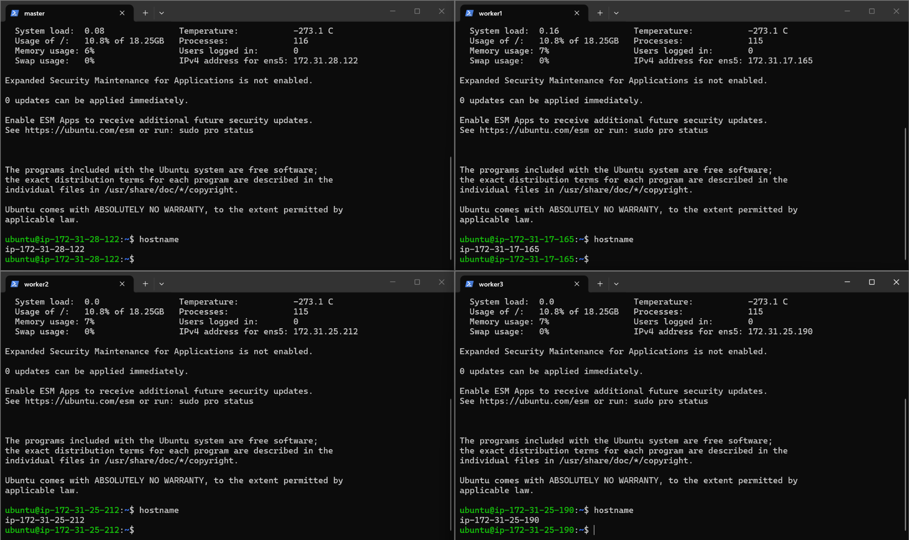

A `PS C:\...>` prompt means local Windows; an `ubuntu@...$` prompt means remote Ubuntu. All subsequent Linux setup commands are executed through SSH unless otherwise specified.

## 5. Install Java, Python and Spark

Run on **all four Ubuntu instances**:

```bash
sudo apt-get update
sudo apt-get install -y openjdk-17-jdk curl wget git
java -version
python3 --version
```

The original Ubuntu system Python reported 3.14.4, which caused a PySpark serialization failure during an early training attempt. Keep the system Python unchanged and install a separate Python 3.11 environment on every host:

```bash
curl -LsSf https://astral.sh/uv/install.sh | sh
export PATH="$HOME/.local/bin:$PATH"
uv python install 3.11
uv venv --python 3.11 "$HOME/spark-venv"
uv pip install --python "$HOME/spark-venv/bin/python" numpy==1.26.4
"$HOME/spark-venv/bin/python" --version
```

The tested environment reported Python 3.11.18; the commands select a compatible 3.11 release. Use the same version on every node.

Install Spark on all four hosts (fresh installation only):

```bash
cd /tmp
wget https://archive.apache.org/dist/spark/spark-3.5.3/spark-3.5.3-bin-hadoop3.tgz
tar -xzf spark-3.5.3-bin-hadoop3.tgz
sudo mv spark-3.5.3-bin-hadoop3 /opt/spark
sudo chown -R ubuntu:ubuntu /opt/spark
/opt/spark/bin/spark-submit --version
```

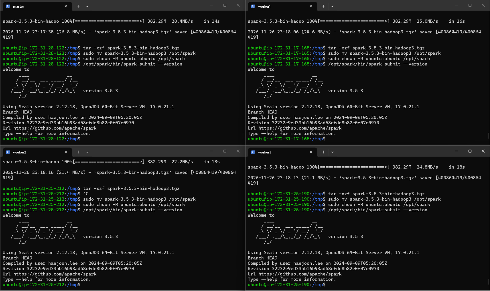

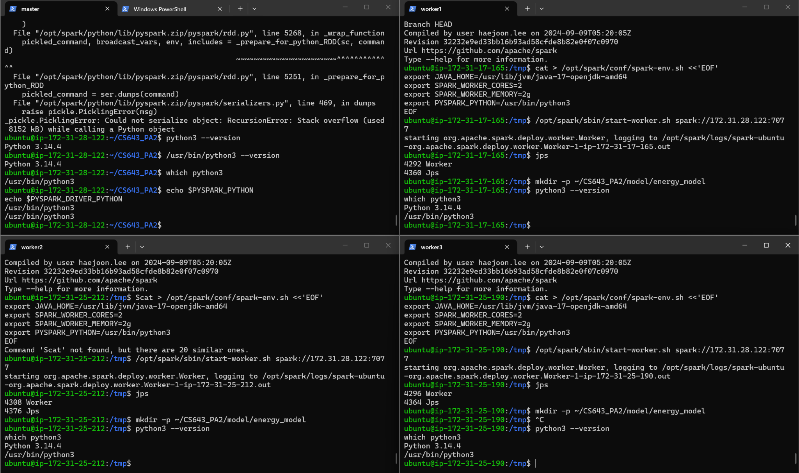

## 6. Configure and start the Spark cluster

On the **master only**, configure the final compatible Python environment:

```bash
cat > /opt/spark/conf/spark-env.sh <<'CONFIG'
export JAVA_HOME=/usr/lib/jvm/java-17-openjdk-amd64
export SPARK_MASTER_HOST=172.31.28.122
export SPARK_MASTER_PORT=7077
export SPARK_MASTER_WEBUI_PORT=8080
export SPARK_WORKER_CORES=1
export SPARK_WORKER_MEMORY=1g
export PYSPARK_PYTHON=/home/ubuntu/spark-venv/bin/python
export PYSPARK_DRIVER_PYTHON=/home/ubuntu/spark-venv/bin/python
CONFIG
/opt/spark/sbin/start-master.sh
/opt/spark/sbin/start-worker.sh spark://172.31.28.122:7077
jps
```

On **each of the three dedicated workers**, run:

```bash
cat > /opt/spark/conf/spark-env.sh <<'CONFIG'
export JAVA_HOME=/usr/lib/jvm/java-17-openjdk-amd64
export SPARK_WORKER_CORES=2
export SPARK_WORKER_MEMORY=2g
export PYSPARK_PYTHON=/home/ubuntu/spark-venv/bin/python
export PYSPARK_DRIVER_PYTHON=/home/ubuntu/spark-venv/bin/python
CONFIG
/opt/spark/sbin/start-worker.sh spark://172.31.28.122:7077
jps
```

For an already running worker, stop it with `/opt/spark/sbin/stop-worker.sh` before restarting with the corrected environment. The master should show `Master` and `Worker`; each dedicated worker should show `Worker`. All should show `Jps` during the check.

The earlier setup screenshot below predates the Python correction; use the final configuration above rather than `/usr/bin/python3` shown in that screenshot. Worker 2 originally had a mistyped command and used its default memory allocation (2.7 GiB); the explicit 2g configuration above is a reproducible alternative sufficient for the seven 1g executors.

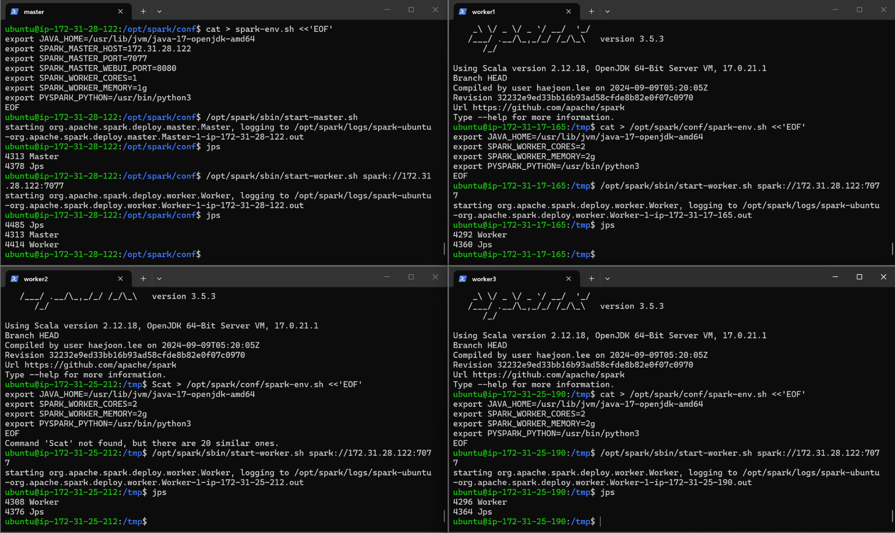

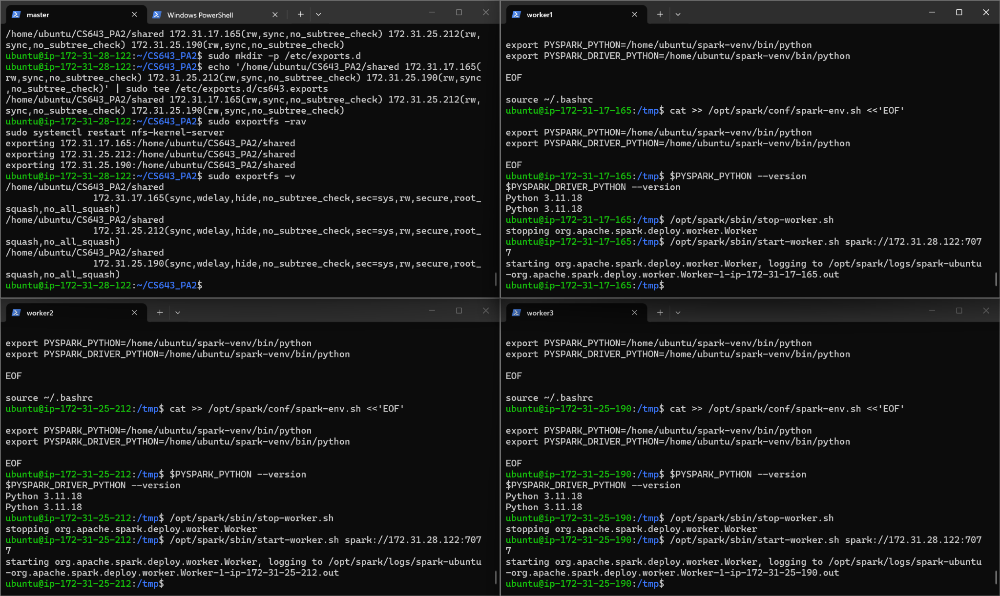

## 7. Verify the Spark dashboard

Open a fifth, separate **local Windows PowerShell** terminal. Keep it open while using the dashboard:

```powershell
ssh -o ServerAliveInterval=60 -o ServerAliveCountMax=5 -i "$HOME\Downloads\cs643-pa2-key.pem" -N -L 8080:localhost:8080 ubuntu@MASTER_PUBLIC_IP
```

Open [http://localhost:8080](http://localhost:8080) in the browser. The recorded dashboard showed four alive workers, seven total cores and 7.7 GiB worker memory. With the explicit 2g dedicated-worker configuration above, the expected total is 7 GiB instead.

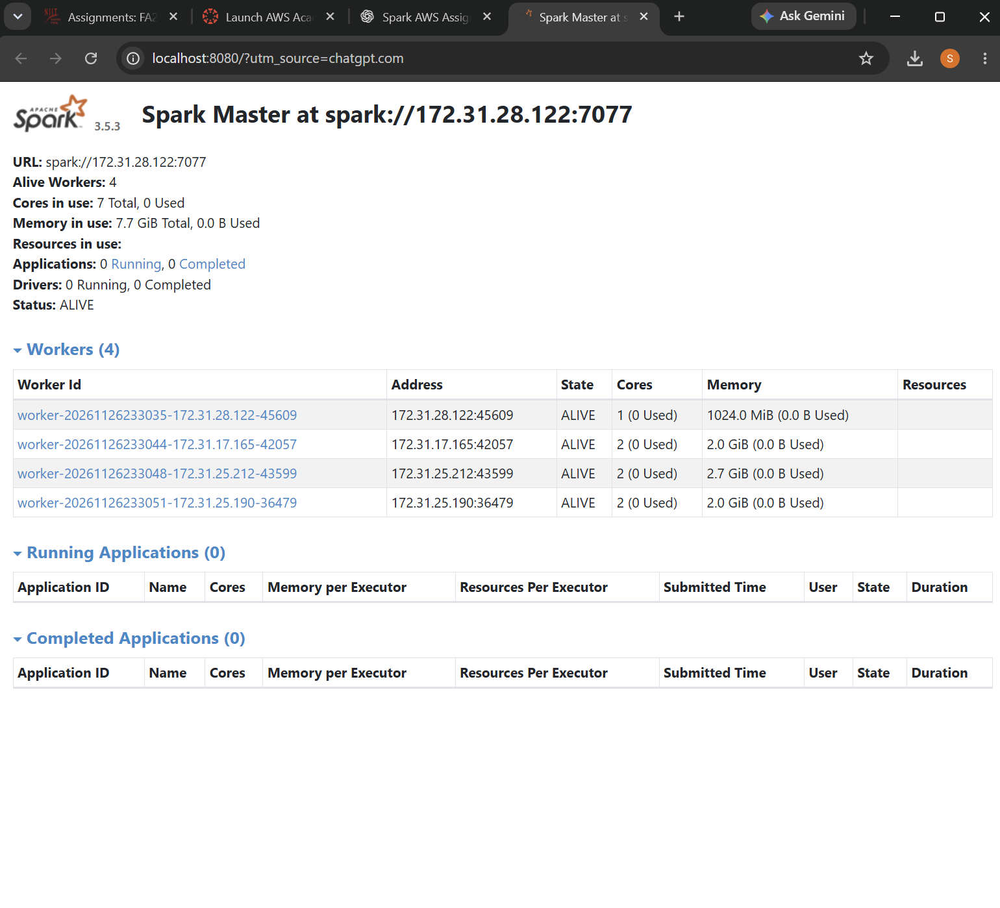

A browser connection refusal after SSH disconnects is resolved by reopening the tunnel and checking the master process. After worker restarts the dashboard may retain old `DEAD` entries; use the **Alive Workers** count rather than the total historical entries.

## 8. Transfer the project and configure shared storage

On the **master**, clone the repository into the expected project path for a new installation:

```bash
cd /home/ubuntu
git clone https://github.com/sai-nikhil-21/CS643-PA2-Energy-Prediction.git CS643_PA2
cd ~/CS643_PA2
mkdir -p data model logs/events shared/data
```

If the project already exists, enter it rather than cloning over it. If the CSV files are missing, download them from Canvas and transfer them from Windows PowerShell:

```powershell
scp -i "$HOME\Downloads\cs643-pa2-key.pem" "$HOME\Downloads\CS643_PA2_Final\data\TrainingDataset.csv" ubuntu@MASTER_PUBLIC_IP:/home/ubuntu/CS643_PA2/data/
scp -i "$HOME\Downloads\cs643-pa2-key.pem" "$HOME\Downloads\CS643_PA2_Final\data\ValidationDataset.csv" ubuntu@MASTER_PUBLIC_IP:/home/ubuntu/CS643_PA2/data/
```

### 8.1 Configure NFS on the master

```bash
cd ~/CS643_PA2
sudo apt-get install -y nfs-kernel-server
mkdir -p shared/data
cp data/TrainingDataset.csv data/ValidationDataset.csv shared/data/
sudo mkdir -p /etc/exports.d
printf '%s\n' '/home/ubuntu/CS643_PA2/shared 172.31.17.165(rw,sync,no_subtree_check) 172.31.25.212(rw,sync,no_subtree_check) 172.31.25.190(rw,sync,no_subtree_check)' | sudo tee /etc/exports.d/cs643.exports
sudo exportfs -rav
sudo systemctl restart nfs-kernel-server
sudo exportfs -v
```

### 8.2 Mount NFS on Worker 1, Worker 2 and Worker 3

```bash
sudo apt-get update
sudo apt-get install -y nfs-common
mkdir -p ~/CS643_PA2/shared
sudo mount -t nfs 172.31.28.122:/home/ubuntu/CS643_PA2/shared /home/ubuntu/CS643_PA2/shared
mountpoint ~/CS643_PA2/shared
ls -lh ~/CS643_PA2/shared/data/
touch ~/CS643_PA2/shared/$(hostname).test
```

Run `ls -l ~/CS643_PA2/shared/*.test` on the master to confirm the worker-created files are visible. The NFS directory must be mounted at the same absolute path on every worker. Remount it after reboot if necessary. Keep NFS exports restricted to the cluster hosts.

The final training screenshot in Section 9 also shows the three workers checking their NFS mountpoints and listing both datasets.

## 9. Train and select the ML model in parallel

The training application uses Spark DataFrames and MLlib regression pipelines. Categorical features are converted using `StringIndexer` and `OneHotEncoder`; `VectorAssembler` combines them with numeric features. `Energy Consumption` is the label and is not included in the feature vector. Models are fitted on the training dataset and compared on the separate validation dataset using `RegressionEvaluator` with `metricName='rmse'`.

The recorded final run compared Linear Regression, Random Forest and Gradient Boosted Trees. The training driver read the local CSV records and distributed them into Spark partitions; model persistence used the NFS directory so distributed writers could access the same filesystem. The worker-host probe reported four distinct executor hosts, demonstrating task execution across all four hosts.

On the **master only**, verify `training/train_model.py` saves to `shared/energy_model`, then run:

```bash
cd ~/CS643_PA2
mkdir -p logs/events model
set -o pipefail
/opt/spark/bin/spark-submit \
  --master spark://172.31.28.122:7077 \
  --deploy-mode client \
  --driver-memory 1g \
  --executor-memory 1g \
  --executor-cores 1 \
  --total-executor-cores 7 \
  --conf spark.driver.host=172.31.28.122 \
  --conf spark.pyspark.python=/home/ubuntu/spark-venv/bin/python \
  --conf spark.pyspark.driver.python=/home/ubuntu/spark-venv/bin/python \
  --conf spark.sql.shuffle.partitions=28 \
  --conf spark.default.parallelism=28 \
  --conf spark.eventLog.enabled=true \
  --conf spark.eventLog.dir=file:///home/ubuntu/CS643_PA2/logs/events \
  training/train_model.py 2>&1 | tee logs/training.log
```

The master URL uses the private IP. Client mode runs the driver on the master EC2 instance, with executors scheduled across the four worker processes. The final run used seven executor cores and reported 800 training rows, 200 validation rows and four executor hosts.

| Model | Validation RMSE (final recorded run) |
| --- | ---: |
| Linear Regression | **0.013731** |
| Random Forest | 302.552231 |
| Gradient Boosted Trees | 207.200652 |

Linear Regression achieved the lowest validation error and was selected.

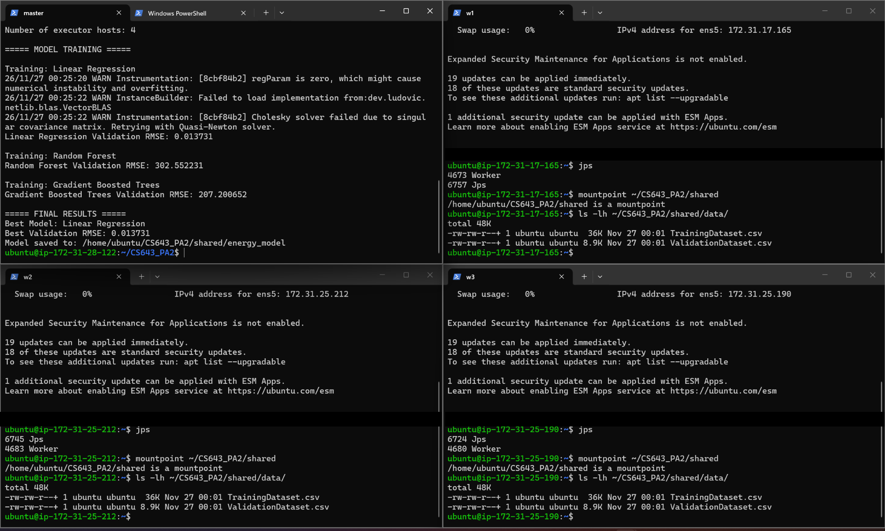

The selected pipeline was saved at `/home/ubuntu/CS643_PA2/shared/energy_model`. Preserve the complete model directory, including metadata and every stage's data, rather than just regression coefficients.

## 10. Run prediction on one EC2 instance (without Docker)

The prediction program loads the trained `PipelineModel` and accepts a CSV path as its positional command-line argument. Its optional `--model` argument selects the model directory. It runs Spark in local mode (`local[2]`), so no remote workers are required. The master EC2 host was reused for this single-machine test.

After training, verify the shared model with the command below before replacing the packaged model:

```bash
cd ~/CS643_PA2
/opt/spark/bin/spark-submit \
  --master 'local[2]' \
  --driver-memory 1g \
  --conf spark.pyspark.python=/home/ubuntu/spark-venv/bin/python \
  --conf spark.pyspark.driver.python=/home/ubuntu/spark-venv/bin/python \
  prediction/predict.py data/ValidationDataset.csv \
  --model /home/ubuntu/CS643_PA2/shared/energy_model
```

After successful prediction, copy the model into the portable project directory (back up an existing model first):

```bash
if [ -d model/energy_model ]; then
  mv model/energy_model "model/energy_model_backup_$(date +%s)"
fi
cp -a shared/energy_model model/energy_model
```

For independent prediction on a fresh Ubuntu EC2 instance, install Java, Spark and the Python environment as in Section 5, clone the repository and run from its root. No Spark master or NFS setup is necessary when using the included model:

```bash
/opt/spark/bin/spark-submit \
  --master 'local[2]' --driver-memory 1g \
  --conf spark.pyspark.python=/home/ubuntu/spark-venv/bin/python \
  --conf spark.pyspark.driver.python=/home/ubuntu/spark-venv/bin/python \
  prediction/predict.py data/ValidationDataset.csv
```

To test another labeled dataset, replace `data/ValidationDataset.csv` with its actual local path (for example `/home/ubuntu/TestDataset.csv`). The test file must contain the same feature columns and the `Energy Consumption` label for RMSE calculation.

Observed output:

```text
===== PREDICTION RESULTS =====
Test records: 200
RMSE: 0.013731
PREDICTION_SUCCESS
```

The application also prints the first ten actual/predicted values. For example, actual `4549.59` was predicted as `4549.598245646542`.

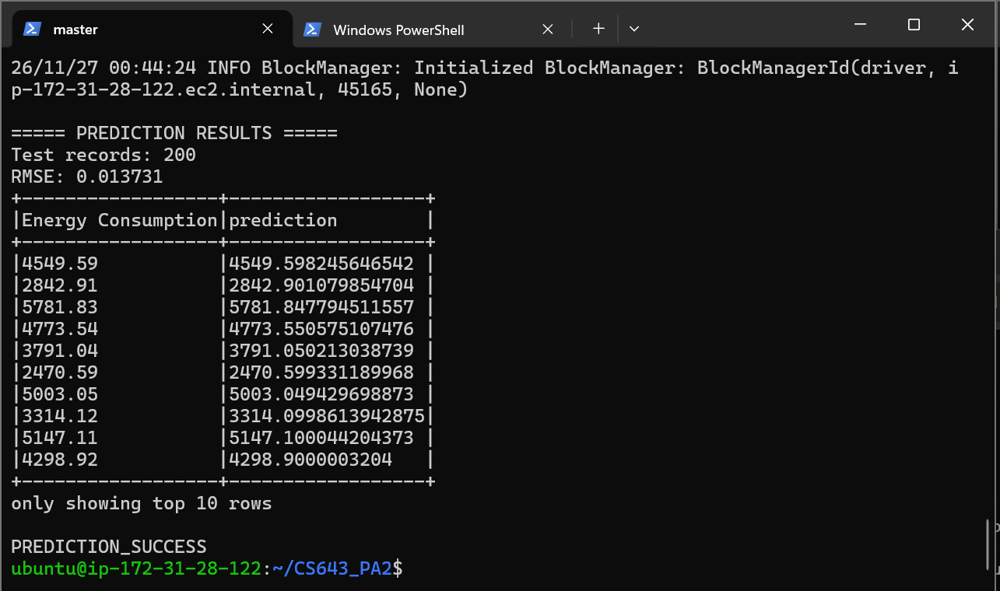

## 11. Build and deploy the Docker prediction container

On the **master EC2 instance**, install Docker Engine and verify it:

```bash
sudo apt-get update
sudo apt-get install -y docker.io
sudo systemctl enable --now docker
sudo docker --version
sudo docker run --rm hello-world
```

The final `Dockerfile` is based on Python 3.11 and installs Java 17, `procps`, PySpark 3.5.3 and NumPy 1.26.4. It copies `prediction/predict.py` and `model/energy_model` into `/app` and launches `spark-submit` in local mode. `SPARK_LOCAL_IP=127.0.0.1` is set for local Spark networking. The CSV is supplied by the caller rather than embedded into the image.

Build from the repository root with the complete saved model:

```bash
cd ~/CS643_PA2
sudo docker build -t cs643-energy-predictor:v1 .
sudo docker images
```

Run on the EC2 host, mounting the host data directory read-only:

```bash
sudo docker run --rm \
  --network none \
  --hostname cs643-predictor \
  --add-host cs643-predictor:127.0.0.1 \
  -v "$PWD/data:/data:ro" \
  cs643-energy-predictor:v1 \
  /data/ValidationDataset.csv
```

The container image was tested with `--network none`, producing 200 predictions and RMSE `0.013731`. The `Dockerfile` was then updated with `procps` to eliminate a missing `ps` warning, rebuilt, and pushed to Docker Hub. Supplying `--hostname cs643-predictor` and `--add-host cs643-predictor:127.0.0.1` avoids Spark hostname resolution warnings when running with `--network none`.

## 12. Pull and run the published Docker image (TA instructions)

The published image is available at [Docker Hub](https://hub.docker.com/r/sainikhild/cs643-energy-predictor). Both `v1` and `latest` tags are published.

On a Linux host with Docker installed, place `TestDataset.csv` in the current directory and run:

```bash
sudo docker pull sainikhild/cs643-energy-predictor:v1
sudo docker run --rm -v "$PWD:/data:ro" sainikhild/cs643-energy-predictor:v1 /data/TestDataset.csv
```

Or run completely offline during prediction using `--network none`:

```bash
sudo docker run --rm \
  --network none \
  --hostname cs643-predictor \
  --add-host cs643-predictor:127.0.0.1 \
  -v "$PWD:/data:ro" \
  sainikhild/cs643-energy-predictor:v1 \
  /data/TestDataset.csv
```

For the supplied validation file, run from the repository root:

```bash
sudo docker run --rm \
  --network none \
  --hostname cs643-predictor \
  --add-host cs643-predictor:127.0.0.1 \
  -v "$PWD/data:/data:ro" \
  sainikhild/cs643-energy-predictor:v1 \
  /data/ValidationDataset.csv
```

The path after the image name is the path **inside** the container, mapped from the local host using `-v`. Pulling requires internet access; prediction does not. The image was built on Linux `amd64`. On another architecture (such as Apple Silicon), add `--platform linux/amd64` if needed.

### Publishing procedure used on the master

Create a public Docker Hub repository named `cs643-energy-predictor`. Authenticate using a personal access token (Read & Write) entered at the password prompt; do not store the token in source code.

```bash
sudo docker login -u sainikhild
sudo docker tag cs643-energy-predictor:v1 sainikhild/cs643-energy-predictor:v1
sudo docker push sainikhild/cs643-energy-predictor:v1
sudo docker tag cs643-energy-predictor:v1 sainikhild/cs643-energy-predictor:latest
sudo docker push sainikhild/cs643-energy-predictor:latest
sudo docker logout
```

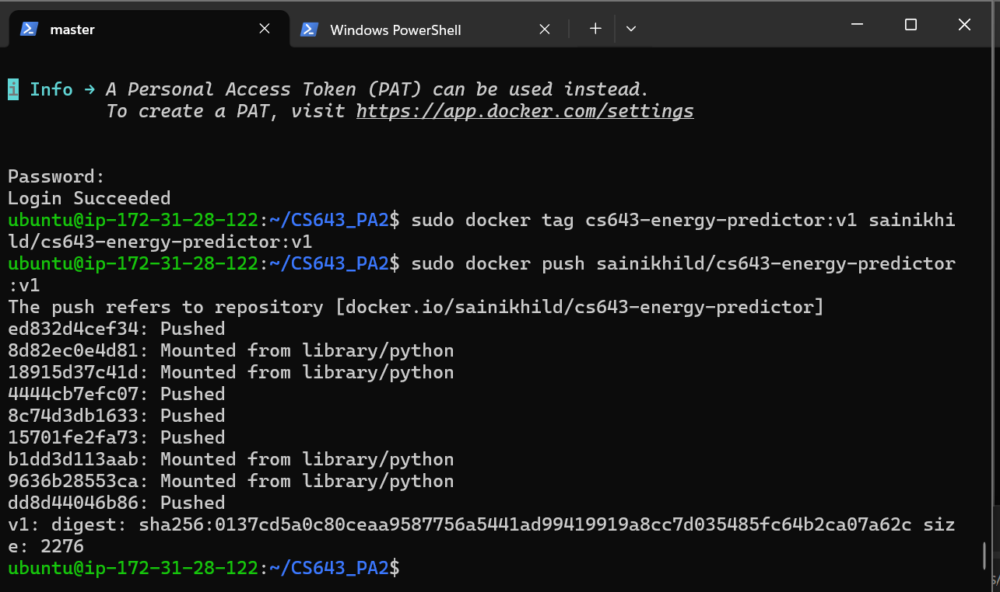

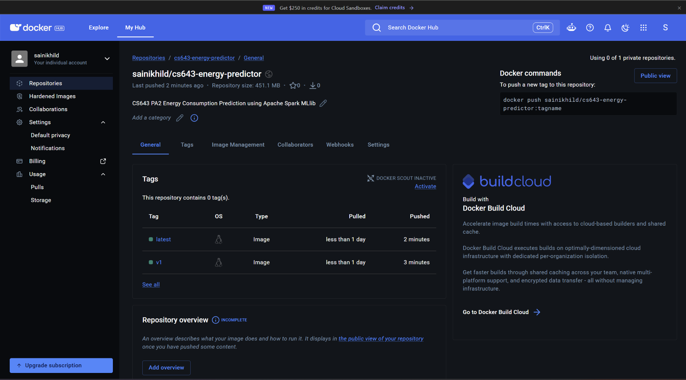

## 13. GitHub publication

The source code, prediction application, saved model and Docker build files were committed locally using Cursor/Git, then published to GitHub on branch `main` using Windows PowerShell (initial commit `f60a59e`).

To add documentation and screenshots to the existing Windows repository:

```powershell
cd "$HOME\Downloads\CS643_PA2_Final"
git status
git remote -v
git branch -vv
git add README.md images .gitignore
git diff --cached --name-only
git commit -m "Document distributed training and prediction"
git push origin main
```

Keep credentials and private keys outside the repository, and verify screenshots before pushing so no AWS account IDs, tokens, or sensitive paths are exposed. The root `.gitignore` excludes `/logs/`, `/shared/`, `/data/`, model backups, private keys and credentials, without excluding nested Spark model data under `model/energy_model/`.

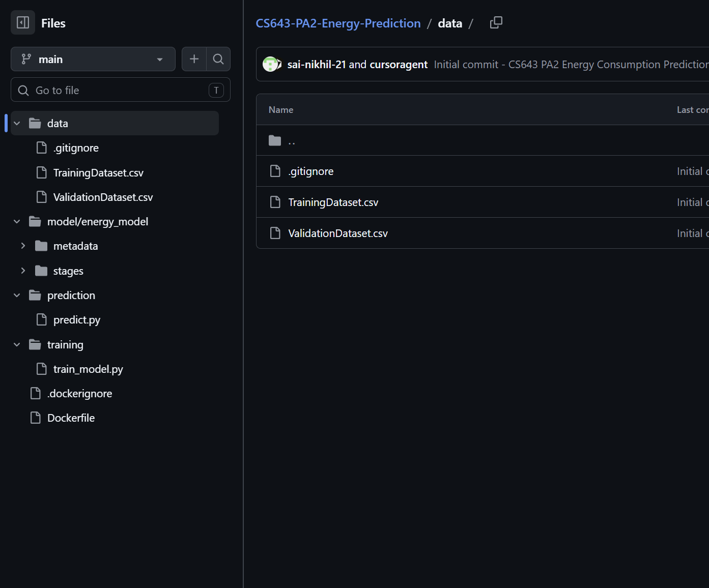

## 14. Results and verification

| Test | Recorded result |
| --- | --- |
| Spark worker connectivity | Four alive worker processes on four distinct EC2 hosts |
| Distributed host probe | Four distinct executor hosts |
| Training / validation records | 800 / 200 |
| Selected model | Linear Regression |
| Distributed validation RMSE | 0.013731 |
| Single-instance prediction RMSE | 0.013731 |
| Docker prediction RMSE | 0.013731 |
| Docker Hub publishing | `v1` and `latest` tags published |
| GitHub publishing | `main` branch published |

The identical validation RMSE (`0.013731`) across distributed training evaluation, single-machine prediction and Docker prediction confirms that the saved `PipelineModel` produces consistent results across all execution environments.

RMSE is the square root of the mean squared difference between actual and predicted target values; lower RMSE indicates lower prediction error in the target's units.

## 15. Troubleshooting and lessons learned

| Issue | Resolution |
| --- | --- |
| Python 3.14.4 caused `PicklingError` / `RecursionError` | Installed a separate Python 3.11 environment on every host and configured both driver and worker interpreter paths. Restarted workers. |
| Worker restart showed old `DEAD` entries | Verified four `ALIVE` workers after restart. |
| `localhost:8080` refused connection | Reopened the SSH port-forwarding tunnel and checked master status. |
| Distributed model saved to nonshared local storage could not be reloaded (`RDD is empty`) | Configured NFS at the same absolute path on every node, saved the model into shared storage, and verified loading with local prediction. |
| SSH connection reset | Reconnected to the existing EC2 instance, checked saved files and logs, and resumed without reinstalling or retraining. |
| Docker `ps` missing / hostname warnings | Initial prediction succeeded; rebuilt with `procps` and supplied an explicit local hostname mapping for `--network none` runs. |
| Git command not recognized in Windows | Exposed Git for Windows to PowerShell, reused the existing local commit and authenticated through GitHub. |

## 16. AI tools used and usefulness

**Tools:** ChatGPT and Cursor AI.

**AI-generated code:** ChatGPT assisted with drafting the Python training and prediction applications, including CSV handling, preprocessing, MLlib regression pipelines, validation RMSE calculation, model selection and persistence, and the command-line prediction interface. It also generated the `Dockerfile` and `.dockerignore` files, setup commands, troubleshooting suggestions and initial README structure. Cursor assisted with the local project setup and Git workflow.

**Code adapted from AI output:** I adapted the training model output path from local storage to the NFS shared directory after the initial distributed save failed to reload. I also updated the cluster environment configuration to use Python 3.11 instead of the incompatible system Python 3.14, and revised the `Dockerfile` to include `procps`.

**Code written from scratch:** No separate application module was written entirely from scratch; my primary engineering work involved configuring and debugging the four-node EC2 cluster, adapting the distributed storage and Python runtime configurations, and validating each stage end-to-end.

**Implementation and verification:** I provisioned and configured the four EC2 instances, connected via SSH, installed all dependencies, configured Spark and NFS, ran distributed training, evaluated the candidate models, tested single-instance and Docker predictions, published the Docker image to Docker Hub, and pushed the repository to GitHub.

**Overall experience:** AI tools were very effective for scaffolding Spark MLlib boilerplate, `Dockerfile` configuration, and troubleshooting explanations. However, their initial outputs did not handle real environment constraints out of the box—specifically Ubuntu's Python 3.14 incompatibility with Spark 3.5.3 and the need for NFS shared storage during distributed model saving. Live testing and iterative debugging on the actual EC2 cluster were essential to make the solution work reliably.

## 17. AWS cleanup

Back up any final source files, logs, and the saved model locally before stopping or terminating AWS resources. When demonstration and grading are complete, terminate the four EC2 instances and remove unused project resources in AWS Academy Learner Lab to avoid unnecessary charges (termination deletes the EBS root volumes).

## References

- [Apache Spark 3.5.3 documentation](https://spark.apache.org/docs/3.5.3/)
- [Spark standalone mode](https://spark.apache.org/docs/3.5.3/spark-standalone.html)
- [Spark ML pipelines](https://spark.apache.org/docs/3.5.3/ml-pipeline.html)
- [Spark regression models](https://spark.apache.org/docs/3.5.3/ml-classification-regression.html)
- [Docker bind mounts](https://docs.docker.com/engine/storage/bind-mounts/)
- [Docker image push](https://docs.docker.com/reference/cli/docker/image/push/)
- [AWS EC2 security groups](https://docs.aws.amazon.com/AWSEC2/latest/UserGuide/ec2-security-groups.html)
